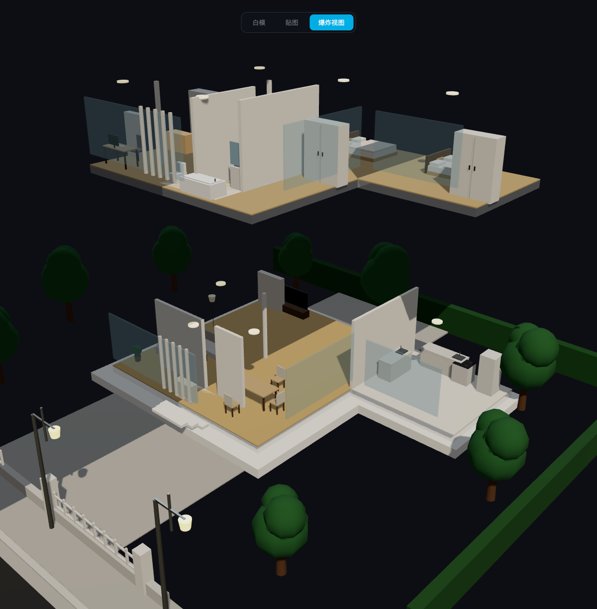

# L 形别墅 — 3D 交互模型

基于 Three.js 的程序化建筑可视化项目，无需后端，纯前端运行，打开即用。



## 亮点

### 三种视图模式

| 模式 | 用途 |
|------|------|
| **白模** | 干净的建筑语言，聚焦空间关系 |
| **贴图** | 材质 + 室内点光源，接近真实氛围 |
| **爆炸视图** | 楼层垂直展开，外墙淡出，室内布局一目了然 |

模式切换有流畅插值动画，外墙在爆炸模式下完全隐去，家具和分隔墙完整呈现。

### 可点击房间

点击任意房间触发线框高亮（低透明度填充 + 线框覆盖层），同时弹出信息面板，显示房间名称、面积和功能说明。高亮设计不遮挡家具可见性。

### 程序化室外场景

- 草坪、车道、人行道、双向公路（含中心虚线）、路沿石
- 10 棵多层叶球的程序化树木，散布场地四周
- 前院低墙 + 门柱 + 栅栏
- 后院石铺露台
- 4 盏路灯（灯头自发光）
- 背景树篱与侧向绿化带

### 自然流水小溪

建筑左侧有一条贯穿南北的溪流：

- **河床** — 深色砾石材质的沟槽
- **石岸** — 两侧程序生成的乱石堆叠，旋转角度随机化
- **水面着色器** — 顶点着色器做多频涟漪位移，片段着色器用多层噪声合成流纹、泡沫和镜面高光，随时间连续动画
- **溪中礁石** — 随机分布的扁平石块

### 丰富屋顶

- 3×2 太阳能板阵列，带金属框架和支撑斜脚
- 两台空调外机，带格栅面板和铜管接口
- 圆柱形储水箱
- 天窗（金属边框 + 玻璃面板）
- 楼梯间出口小屋，带门板
- 主楼四周金属护栏（立柱 + 顶横杆）

### 精细的建筑外观

- 入口台阶（三级）
- 正立面竖向格栅装饰
- 多组玻璃幕墙（主楼正面、侧面、翼楼正面）
- L 形平面：主楼 9×10、翼楼 5×4.5，布局精确

### 实时性能与光线控制

- 左上角 FPS 计数器，30 帧滚动均值，每 250ms 刷新
- 右上角光线滑块，实时调节曝光值、环境光、主光、补光四个参数

---

## 技术栈

- **Vite** — 构建工具
- **Three.js** — 3D 渲染（纯 API，无封装框架）
- **TypeScript** — 类型安全
- **pnpm** — 包管理
- **ShaderMaterial** — 自定义水面 GLSL 着色器
- **OrbitControls** — 惯性轨道相机，阻尼平滑
- **ACES Filmic** 色调映射 + PCFSoft 阴影

## 快速开始

```bash
pnpm install
pnpm dev
```

浏览器打开 `http://localhost:5173` 即可。

## 构建

```bash
pnpm build
```

产物输出到 `dist/`，任意静态服务器托管即可，无需服务端。

## 项目结构

```
src/
  main.ts        # 场景、相机、灯光、交互、动画循环
  building.ts    # L 形建筑几何（楼层、外墙、屋顶）
  interiors.ts   # 室内地板、隔墙、家具（两层）
  outdoor.ts     # 室外场景 + 溪流水面着色器
  rooms.ts       # 房间元数据（名称、面积、描述）
  style.css      # UI 样式
index.html
```

## 许可

MIT
